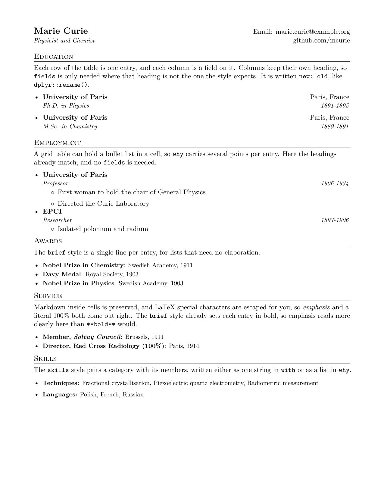

# Jake's Resume

A Quarto format for writing a resume with the LaTeX template packaged at
[sb2nov/resume](https://github.com/sb2nov/resume) by Sourabh Bajaj — the
single most-copied resume template on Overleaf, where it circulates under the
nickname "Jake's Resume". CV entries are written as tables, either by hand or
generated by code.

<table>
<tr>
<td width="320"></td>
<td><code>format: sb2nov-pdf</code><br>A single-column, black-and-white ATS resume: a name and contact header over sections built from <code>.entries</code> tables, in the <code>detailed</code>, <code>brief</code> and <code>skills</code> styles.</td>
</tr>
</table>

## Installing

```bash
quarto use template quarto-vitae/sb2nov
```

This installs the extension and creates a starting `template.qmd`. To add the
format to a document you already have, use `quarto add quarto-vitae/sb2nov`.

Rendering needs a LaTeX installation with **pdflatex**. If you have no LaTeX,
`quarto install tinytex` will do; upstream uses only pdfTeX-safe packages, so
nothing needs fetching from a font server on the first render.

## Using

Set the format and describe yourself in the YAML header:

```yaml
---
name: Marie
surname: Curie
position: "Physicist and Chemist"
email: "marie.curie@example.org"
github: mcurie
format: sb2nov-pdf
---
```

Write each section as a heading, and each listing as a table inside an
`.entries` div. One row becomes one entry, and one column becomes one field on
it, named by its heading:

```markdown
# Education

::: {.entries style="detailed"}
| what             | with                | when      | where         |
|------------------|---------------------|-----------|---------------|
| Ph.D. in Physics | University of Paris | 1891-1895 | Paris, France |
:::
```

Where your data uses different headings, rename them with `fields`, written
`new: old` in the manner of `dplyr::rename()`:

```markdown
::: {.entries style="detailed" fields="{what: Degree, with: Institution, when: Years}"}
```

Markdown inside table cells is preserved, so `**bold**`, `*italic*` and links
all work. LaTeX special characters are escaped for you exactly once, so a
literal `100%` needs no backslash.

### Entries from code

More often the data lives in a data frame, and the same options are given as
cell options. The cell prints a table and the filter picks it up:

````markdown
```{r}
#| echo: false
#| vitae:
#|   style: detailed
#|   fields:
#|     what: degree
#|     with: institution
#|     when: years
education |> filter(completed)
```
````

Entries can also come from a CSV printed by a cell, from several tables in one
div, or carry bullet lists written in grid table cells. Those are covered in the
[vitae documentation](https://quarto-vitae.github.io/).

## Styles

This format implements the three conventional vitae listing styles.

`detailed`
: A multi-line entry using `what`, `with`, `where` and `when`, with a bulleted
  elaboration built from `why`. Suits education and employment. This is the
  style used when none is given.

`brief`
: A single line per entry, from `what`, bolded, followed by `where` (falling
  back to `with`) and `when`. Suits awards, memberships and service. `what` is
  set in bold, so use `*emphasis*` rather than `**bold**` to pick out part of
  it.

`skills`
: A category in `what` paired with its members, given either as one string in
  `with` or as a list in `why`.

## Format options

Set these in the YAML header. All are optional except `name`.

### Header contents

| Option | Effect |
|--------|--------|
| `name`, `surname` | The name shown in the header |
| `position` | A subtitle line under the name |
| `phone`, `email`, `www` | Contact details, stacked at the right of the header |
| `github`, `linkedin` | Profiles, stacked below the contact details |

Upstream's own header links only the name and lists exactly Email and Mobile;
this template generalises that to whichever of the fields above are actually
set, in the same order.

### Appearance

| Option | Effect |
|--------|--------|
| `headcolor` | Accent colour as a hex string, such as `"8C1E1E"`, tinting the section rule and heading text. Jake's Resume is otherwise black and white, so this defaults to black. |
| `fontsize` | Base font size, defaulting to `11pt`. |
| `papersize` | Paper size, defaulting to `letter`, matching upstream. Use `a4` to switch. |
| `geometry` | Page margins, passed to the `geometry` package. Defaults to upstream's own tight margins. |
| `linestretch` | Line spacing. |
| `colorlinks` | Set to `true` to colour links. Off by default, matching upstream's plain, unboxed `hidelinks`. |

Unlike Awesome-CV or latexcv, this design has no footer, page numbers or
profile picture: upstream is a single-page ATS resume with none of those, and
this port keeps it that way.

### Typography

This format renders with **pdflatex** by default, matching upstream, so the
font is changed with `fontfamily`, the name of a LaTeX font package, rather
than `mainfont`:

```yaml
fontfamily: "tgpagella" # TeX Gyre Pagella
```

`mainfont` (naming any font installed on the system, rather than a LaTeX
package) works too, but only once `pdf-engine` is switched to `xelatex` or
`lualatex`, since it depends on `fontspec`, which pdflatex cannot use.

## Licensing

Released under CC BY-SA 4.0, see [LICENSE](LICENSE.md). Built on
[sb2nov/resume](https://github.com/sb2nov/resume) ("Jake's Resume") by Sourabh
Bajaj, released under the MIT License.

---

> [!TIP]
> **This is one of several vitae templates for Quarto.**
>
> They share the same entry syntax, so a CV written here can be rendered with a
> different design by changing the `format:` line. To browse the other
> templates, read the full guide to writing a CV, or build a template of your
> own, visit <https://quarto-vitae.github.io/>.
